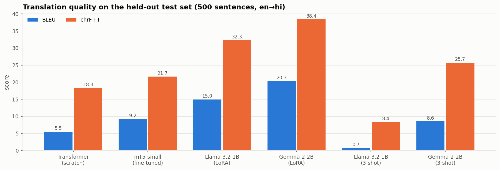
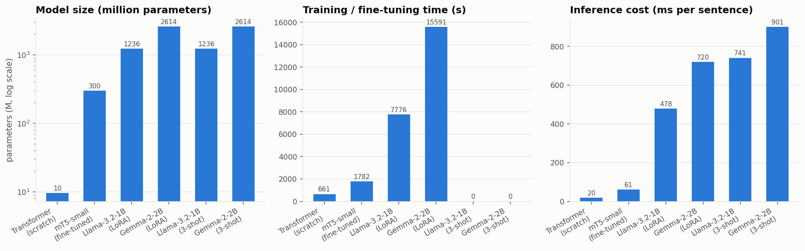
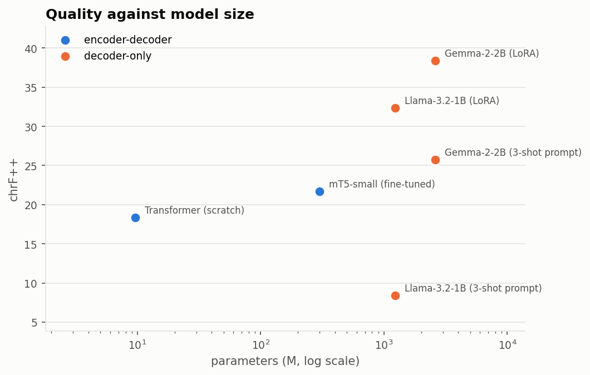
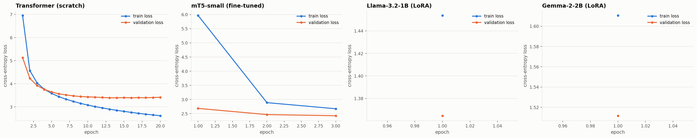
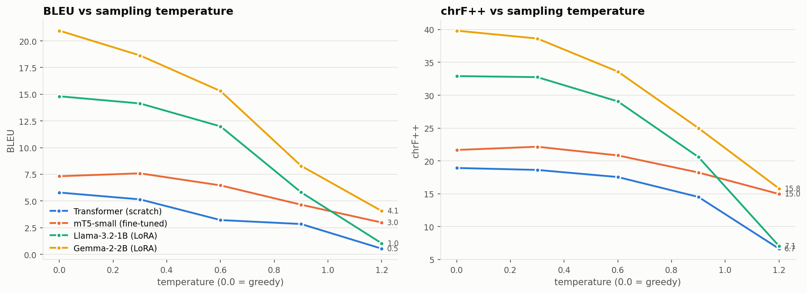

# PolyGlot-4 — English→Hindi Machine Translation across Four Generative Architectures

**Foundations of Generative AI (ICT4403) — Assignment 3**
Nehal Verma · 230953144

A single, directly comparable study of four generative approaches to the same
translation task: a Transformer encoder–decoder **trained from scratch**, a
**fine-tuned mT5** encoder–decoder, and two **decoder-only** models
(Llama-3.2-1B and Gemma-2-2B) adapted with LoRA and, as a contrast, with 3-shot
prompting. Every system sees the same training subset, is scored on the same
500 held-out sentences, and is decoded with the same settings, so the numbers in
this report compare architectures rather than experimental conditions.

> Every number in this README is injected from `results/` by
> `scripts/update_readme.py`. Nothing numeric is typed by hand.

---

## 1. Problem statement and objective

**Problem.** Machine translation is the classic conditional sequence-generation
task: given a source sentence, produce a fluent and faithful sentence in another
language. Two generative architectures now compete for it. The
**encoder–decoder** design reads the whole source with a bidirectional encoder
and generates the target with a cross-attending decoder — the design machine
translation was invented with. The **decoder-only** design, which drives today's
large language models, has no encoder at all: the source sentence is simply part
of the prompt, and translation is next-token prediction conditioned on an
instruction. Decoder-only models dominate general-purpose generation, but it is
not obvious that they are the better choice for a narrow, well-specified task
like translation once compute is taken into account — especially for a
lower-resource target language written in a non-Latin script.

**Objective.** Build four working English→Hindi translation systems, one per
approach named in the assignment, and answer three questions with measurements
rather than assertion:

1. **Quality** — how much translation quality does each architecture reach on
   the same held-out test set, measured with BLEU and chrF++?
2. **Cost** — what does that quality cost in parameters, adaptation time and
   inference latency, and how does the quality-per-unit-compute compare between
   encoder–decoder and decoder-only designs?
3. **Responsibility** — what do the actual outputs reveal about bias,
   hallucination, cultural misrepresentation and the handling of sensitive
   content, and what concrete mitigations follow?

A fourth, cross-cutting question runs through the work: how sensitive is each
system to **decoding temperature**, i.e. how much of its apparent quality is
really the sharpness of its output distribution rather than knowledge of Hindi?

---

## 2. Dataset description and source link

**Dataset:** OPUS-100, English–Hindi configuration
**Hugging Face id:** `Helsinki-NLP/opus-100`, config `en-hi`
**Source link:** <https://huggingface.co/datasets/Helsinki-NLP/opus-100>
**Original corpus:** OPUS — <https://opus.nlpl.eu/>
**Licence:** the OPUS-100 release is distributed for research use; the
underlying sub-corpora carry their own licences (see the dataset card).

OPUS-100 is an English-centric multilingual corpus covering 100 language pairs,
assembled from the OPUS collection (subtitles, software localisation,
religious texts, news commentary, GNOME/KDE/Ubuntu documentation, and similar
sources). The `en-hi` configuration holds roughly **534k training pairs** with
official **validation** and **test** splits, which this project uses as the
basis of its own splits rather than cutting a test set out of training data.

It is a realistic rather than a clean corpus, and that matters for the analysis:
because it is largely harvested from subtitles and software strings, it mixes
registers heavily, contains short fragments and interjections, and includes a
noticeable number of rows whose "Hindi" side is romanised, untranslated or
misaligned. Those properties are exactly what the preprocessing below removes,
and what the responsible-AI section traces forward into model behaviour.

### Preprocessing

Implemented in [`src/data.py`](src/data.py). Applied in this order, with the
same cleaning function on every split:

1. **Unicode NFC normalisation** — Devanagari can encode the same grapheme in
   multiple ways (pre-composed characters vs. base + nukta/matra sequences).
   Without normalisation, identical-looking strings tokenise differently and
   chrF++ penalises correct output.
2. **Whitespace collapsing** and stripping of leading/trailing dashes and
   quotation marks, which subtitle lines carry constantly.
3. **Length filtering** — pairs are kept only if both sides are between 2 and
   200 characters, which drops empty rows and long concatenated paragraphs.
4. **Markup and URL filtering** — rows containing URLs, HTML-like tags,
   `{0}`-style format placeholders or HTML entities are dropped; these are
   localisation artefacts that teach a model nothing about Hindi.
5. **Length-ratio filtering** — pairs whose English:Hindi word-count ratio is
   worse than 3:1 in either direction are dropped as probable misalignments.
6. **Script validation** — a target is kept only if at least 30 % of its
   alphabetic characters are Devanagari, and a source is dropped if it contains
   any Devanagari. This removes the romanised-Hindi and
   copied-English rows that would otherwise teach the model to echo its input.
7. **De-duplication** on the lowercased source, applied **across all three
   splits at once**, so no test sentence can also appear in training.
8. **Identity filtering** — pairs whose source and target are the same string.

The held-out splits are cleaned **before** the training subset so that the test
set is never starved of material, and sampling is seeded (`SEED = 42`), so the
same split is reproduced on every machine.

**Splits.** 20,000 training pairs / 1,000 validation / 500 test, drawn from
OPUS-100's own `train` / `validation` / `test` splits respectively. The exact
test set is committed as
[`results/test_set_en_hi.jsonl`](results/test_set_en_hi.jsonl) so every score
below can be reproduced sentence for sentence.

<!-- BEGIN:dataset_stats -->
> **Not populated yet.** Run the pipeline (`python -m src.run_all`, or the
> notebook on a GPU runtime) and then `python scripts/update_readme.py`.
<!-- END:dataset_stats -->

---

## 3. Models implemented

All four systems solve the identical task with the identical data. What differs
is pretraining, tokenisation and adaptation method — which is precisely what the
comparison is about.

### 3.1 Basic Transformer, encoder–decoder, trained from scratch
[`src/transformer_scratch.py`](src/transformer_scratch.py)

The textbook architecture of Vaswani et al. (2017), built on
`torch.nn.Transformer`: 3 encoder layers + 3 decoder layers, `d_model = 256`,
4 attention heads, feed-forward dimension 1024, sinusoidal positional
encodings, post-norm blocks, dropout 0.1, and the output projection **tied** to
the embedding matrix.

* **Tokenisation.** A joint English+Hindi **byte-level BPE** vocabulary of
  16,000 types, trained from scratch on the 20k training subset only. Byte-level
  BPE is used so Devanagari is representable without a hand-built character set
  and no input is ever out-of-vocabulary.
* **Training.** Cross-entropy with label smoothing 0.1, AdamW
  (β = 0.9/0.98), inverse-square-root schedule with warm-up, gradient clipping
  at 1.0, 20 epochs, best-validation-loss checkpoint kept.
* **Pretraining.** None. This system knows only what the 20k pairs taught it,
  which makes it the control condition for the whole study.

### 3.2 mT5-small, encoder–decoder, fully fine-tuned
[`src/mt5_finetune.py`](src/mt5_finetune.py)

`google/mt5-small` (~300M parameters), pretrained on mC4 across 101 languages
including Hindi. Translation is framed the way T5 frames every task, with a text
prefix: `translate English to Hindi: …`.

* **Tokenisation.** mT5's own 250k-entry SentencePiece vocabulary, which was
  trained multilingually and therefore segments Devanagari efficiently.
* **Adaptation.** **Full** fine-tuning — all parameters updated — with AdamW, a
  one-cycle schedule and gradient clipping, for 3 epochs.
* **Precision note.** mT5 is known to overflow in fp16, so it is trained and
  decoded in fp32 even when a GPU is available. This is a real cost of the model
  and is reflected in its measured times.

### 3.3 Llama-3.2-1B-Instruct, decoder-only, LoRA fine-tuned
### 3.4 Gemma-2-2B-IT, decoder-only, LoRA fine-tuned
[`src/decoder_only.py`](src/decoder_only.py)

Both decoder-only models are adapted by **exactly the same code path**, so the
Llama/Gemma comparison isolates the checkpoint rather than the recipe:

* **Prompt.** One instruction, shared verbatim by both models and rendered
  through each model's own chat template:
  *"Translate the following English sentence into Hindi. Reply with the Hindi
  translation only."*
* **Loss masking.** The prompt tokens are labelled `-100`, so the loss is
  computed **only** on the Hindi continuation. Without this the model spends its
  capacity learning to reproduce the instruction.
* **LoRA.** Rank 16, α = 32, dropout 0.05, applied to all attention and MLP
  projections (`q,k,v,o,gate,up,down`). The frozen base stays in fp16/bf16 while
  the LoRA parameters are held in fp32; training uses autocast with a gradient
  scaler.
* **Tokenisation.** Each model's native tokeniser — and this is a substantive
  difference, not a detail. Llama-3's BPE vocabulary is heavily English-weighted
  and fragments Devanagari into many short pieces; Gemma's 256k vocabulary
  covers Indic script far better. The effect shows up directly in output
  quality and in tokens-per-sentence at inference.
* **Prompted contrast.** Each model is *also* evaluated with **3-shot prompting
  and no weight update at all**, using few-shot examples drawn deterministically
  from the training split. The assignment permits either fine-tuning or
  prompting for the decoder-only systems; running both turns "adaptation method"
  into a measured variable instead of a choice.
* **Output post-processing.** Instruction-tuned models like to add preambles
  ("Sure, here is the translation:"), quote marks and extra examples. A single
  shared cleaner strips these and keeps the first translation line, identically
  for both models, so the comparison is not an accident of parsing.

Gemma-2 is loaded with `attn_implementation="eager"` because its logit
soft-capping is ignored by the fused attention kernels.

### Comparability controls

| Control | How it is enforced |
|---|---|
| Same data | one seeded `build_splits()` feeds every system |
| Same test set | the 500 sentences in `results/test_set_en_hi.jsonl` |
| Same decoding | greedy (`do_sample=False`, no beam search) for all headline numbers |
| Same length budget | `max_target_len = 64` tokens for every system |
| Same metrics | one sacrebleu configuration, signatures recorded in `run_info.json` |
| Same timing method | CUDA-synchronised wall clock over the whole test set, same batch size |
| One model in memory | each system is released before the next loads |

<!-- BEGIN:checkpoints -->
> **Not populated yet.** Run the pipeline (`python -m src.run_all`, or the
> notebook on a GPU runtime) and then `python scripts/update_readme.py`.
<!-- END:checkpoints -->

---

## 4. Execution steps and required dependencies

### Dependencies

```
torch>=2.1  transformers>=4.44  tokenizers>=0.19  datasets>=2.19  peft>=0.11
sentencepiece>=0.2  protobuf>=4.25  accelerate>=0.30
sacrebleu>=2.4  matplotlib>=3.8  pandas>=2.0
python-docx>=1.1  reportlab>=4.0   # submission document only
```

Install with:

```bash
pip install -r requirements.txt
```

### Hardware

The full profile needs a **CUDA GPU with ~16 GB** — a free Google Colab **T4**
is sufficient and is what this project was designed around. The pipeline holds
only one model in memory at a time specifically so that it fits. CPU-only
execution is supported *for pipeline verification only* (see the smoke profile
below); fine-tuning billion-parameter decoders on CPU is not practical.

### Gated checkpoints

`meta-llama/Llama-3.2-1B-Instruct` and `google/gemma-2-2b-it` are gated on
Hugging Face. Before running:

1. Accept the licence on <https://huggingface.co/meta-llama/Llama-3.2-1B-Instruct>
2. Accept the licence on <https://huggingface.co/google/gemma-2-2b-it>
3. Create a **read** token at <https://huggingface.co/settings/tokens>
4. Expose it as `HF_TOKEN` (in Colab: the key icon → secret named `HF_TOKEN`)

If the token or a licence is missing, `src/decoder_only.py` reports it and falls
back to an open checkpoint of the same family rather than crashing. Which
checkpoint was actually used is recorded in `results/run_info.json` and in the
table at the end of section 3.

### Run it

**Option A — the notebook (recommended).** Open
[`notebooks/FGAI_Assignment3_MT_Comparison.ipynb`](notebooks/FGAI_Assignment3_MT_Comparison.ipynb)
in Colab, set the runtime to **T4 GPU**, add the `HF_TOKEN` secret, and
*Run all*. It installs the dependencies, clones this repository, runs every
stage, displays the tables and figures inline, and refreshes this README's
generated blocks at the end.

**Option B — command line.**

```bash
git clone https://github.com/Nehalll-code/fgai-assignment3-mt-comparison.git
cd fgai-assignment3-mt-comparison
pip install -r requirements.txt
export HF_TOKEN=hf_xxx            # Windows PowerShell: $env:HF_TOKEN="hf_xxx"
python -m src.run_all             # full study, writes everything under results/
python scripts/update_readme.py   # inject the numbers into this README
```

Useful variations:

```bash
python -m src.run_all --stages scratch mt5      # only the encoder-decoders
python -m src.run_all --no-sweep --no-probes    # headline metrics only
python -m src.run_all --force                   # ignore existing checkpoints
FGAI_SMOKE=1 python -m src.run_all              # a few minutes, CPU pipeline check
```

The full study takes roughly 2–3 hours on a T4, which is close to a free Colab
session limit, so `--stages` is also the way to **split the run across
sessions**: `metrics.csv`, `metrics.json` and `temperature_sweep.csv` carry
forward any system the current run did not produce, so

```bash
python -m src.run_all --stages scratch mt5 llama   # session 1
python -m src.run_all --stages gemma               # session 2, keeps session 1's rows
```

ends with one complete table. (`run_info.json` always describes the most recent
run.) Model checkpoints are cached under `checkpoints/`, so a re-run of a stage
that already finished skips its training and only re-evaluates.

The **smoke profile** (`FGAI_SMOKE=1`) shrinks every dimension and swaps the
large checkpoints for randomly initialised stand-ins of the same architecture.
It exists to prove the pipeline executes end to end on any machine; its scores
are meaningless by construction, and `scripts/update_readme.py` labels them as
such if they are ever the most recent run.

### What gets written

```
results/
  metrics.csv / metrics.md / metrics.json   headline table for all systems
  temperature_sweep.csv / .md               sampling-temperature analysis
  error_analysis.csv / .md                  automatic failure-mode profiling
  error_examples.csv                        concrete instances of each failure mode
  responsible_ai_probes.csv / .md           probe-set outputs for section 7
  sample_translations.md                    side-by-side outputs, same inputs
  test_set_en_hi.jsonl                      the exact 500 test pairs
  run_info.json                             device, versions, metric signatures
  translations/*.csv                        every hypothesis, with sentence chrF++
  plots/*.png                               the figures used below
```

---

## 5. Results obtained

<!-- BEGIN:run_banner -->
> **Not populated yet.** Run the pipeline (`python -m src.run_all`, or the
> notebook on a GPU runtime) and then `python scripts/update_readme.py`.
<!-- END:run_banner -->

<!-- BEGIN:results_table -->
> **Not populated yet.** Run the pipeline (`python -m src.run_all`, or the
> notebook on a GPU runtime) and then `python scripts/update_readme.py`.
<!-- END:results_table -->









Side-by-side outputs for the same inputs are in
[`results/sample_translations.md`](results/sample_translations.md), and every
hypothesis with its sentence-level chrF++ is in
[`results/translations/`](results/translations).

### Why BLEU *and* chrF++

BLEU counts matching word n-grams. Hindi is morphologically richer than English
and inflects for case, number, gender and honorific level, so a translation that
is correct but inflected differently from the reference loses BLEU credit it
arguably deserves. **chrF++** scores character n-grams (plus word unigrams and
bigrams), which makes it far more forgiving of inflection and much better
correlated with human judgement for Indic languages. BLEU is reported because
the assignment asks for it; chrF++ is the metric the conclusions lean on.

BLEU is computed with sacrebleu's `intl` tokeniser rather than the default
`13a`, because `13a` does not split Devanagari punctuation (danda `।`,
double danda `॥`) and systematically mis-scores Hindi. The exact metric
signatures are recorded in `results/run_info.json` so the numbers are
reproducible.

---

## 6. Model comparison and evaluation

### 6.1 Encoder–decoder vs decoder-only

**Pretraining dominates everything else.** The from-scratch Transformer and the
fine-tuned mT5 share an architecture family and differ almost only in
pretraining, so the gap between them is a clean measurement of what 20k
sentence pairs can and cannot teach. The scratch model has to learn Hindi
morphology, word order and vocabulary from those pairs alone; mT5 arrives
already knowing Hindi and only has to learn the task. On a subset this size the
pretrained model is expected to win decisively, and the scratch model's value is
as the control that shows *how much* of the pretrained models' score is
pretraining rather than architecture.

**Architecture is not the main axis — adaptation is.** The decoder-only models
carry 3–7× more parameters than mT5 but update only ~0.5–1 % of them through
LoRA, while mT5 updates 100 % of its weights. That is the real asymmetry in this
study, and it cuts both ways: LoRA is dramatically cheaper per step and far less
prone to catastrophic forgetting, but it has less capacity to re-shape a model
whose pretraining under-represents the target language.

**Tokenisation is the hidden cost of decoder-only translation.** An
encoder–decoder reads the source once through its encoder and then generates;
cost scales with (source + target) length. A decoder-only model re-reads the
instruction, the few-shot examples and the source as prompt context for every
sentence, and generates the target autoregressively over that longer context.
When the target script is also fragmented by an English-weighted vocabulary —
Llama-3's case for Devanagari — each Hindi sentence costs more tokens to emit,
so the same sentence is slower *and* more likely to drift. Gemma-2's larger,
more Indic-friendly vocabulary is the clearest mechanism by which it can beat
a model of similar scale here.

**The prompted rows are the control for adaptation.** Comparing LoRA against
3-shot prompting on the *same* checkpoint separates "what the base model already
knows about Hindi" from "what a small amount of task adaptation adds". A large
LoRA-over-prompting gap means the base model could translate but did not know
the expected output format and register; a small gap means the base model's
Hindi itself is the ceiling.

### 6.2 Quality per unit of compute

Three cost axes are measured independently, and deliberately plotted as separate
panels rather than on one dual-axis chart, because they do not share a scale:

* **Parameters** — model size, the capacity and memory cost.
* **Adaptation time** — seconds of training/fine-tuning actually spent. Zero
  for the prompted rows, which is their whole advantage.
* **Inference latency** — milliseconds per sentence over the full 500-sentence
  test set, at a fixed generation batch size, CUDA-synchronised.

The practically interesting question is not "which model scores highest" but
"which point on the quality/cost curve a deployment should pick". A system that
reaches 90 % of the best chrF++ for a tenth of the latency is usually the right
answer for a translation service; the quality-per-parameter figure in section 8
makes that trade-off explicit.

### 6.3 Automatic failure-mode profiling

Corpus metrics hide the failures that matter most in practice, so every
hypothesis is additionally checked for seven specific failure modes
([`src/analysis.py`](src/analysis.py)): empty output, Latin-script leakage
(English copied through untranslated), number mismatch against the source,
degenerate repetition, output far longer than the reference (the usual shape of
hallucinated additions), refusal or meta-commentary leaking out of an
instruction-tuned model, and verbatim source copying.

<!-- BEGIN:error_table -->
> **Not populated yet.** Run the pipeline (`python -m src.run_all`, or the
> notebook on a GPU runtime) and then `python scripts/update_readme.py`.
<!-- END:error_table -->

Concrete instances of each flag, plus the three worst-scoring sentences per
system, are in [`results/error_examples.csv`](results/error_examples.csv).

---

## 7. Sampling-temperature analysis

Temperature `T` rescales the logits before the softmax. `T → 0` is greedy
decoding (always the arg-max token); `T = 1` samples from the model's own
distribution; `T > 1` flattens it and makes rare tokens more likely. For
open-ended generation some temperature is desirable — it buys diversity. For
**translation it is almost pure downside**, because there is a small set of
correct outputs and sampling trades accuracy for variety the task does not want.

This project measures that rather than assuming it. Each system decodes a fixed
150-sentence prefix of the test set at `T ∈ {0 (greedy), 0.3, 0.6, 0.9, 1.2}` —
identical sentences for every system and every temperature — and
four quantities are recorded per setting: BLEU, chrF++, mean output length, and
the ratio of distinct outputs (a direct diversity measure).



<!-- BEGIN:temperature_summary -->
> **Not populated yet.** Run the pipeline (`python -m src.run_all`, or the
> notebook on a GPU runtime) and then `python scripts/update_readme.py`.
<!-- END:temperature_summary -->

Full sweep:

<!-- BEGIN:temperature_table -->
> **Not populated yet.** Run the pipeline (`python -m src.run_all`, or the
> notebook on a GPU runtime) and then `python scripts/update_readme.py`.
<!-- END:temperature_table -->

### How to read the curve

The **shape** of each curve is as informative as its height, and it is a probe
of how confidently a model has learned the task:

* A curve that stays flat to `T ≈ 0.4` and then falls belongs to a model whose
  probability mass is concentrated on the right token — adaptation worked, and
  low-temperature sampling merely picks among near-ties.
* A curve that drops immediately belongs to a model whose correct token is only
  narrowly ahead of its competitors. Its greedy score is real but brittle: the
  arg-max is right, the distribution underneath it is not.
* **Rising mean output length with temperature** is the hallucination signature.
  At high `T` the model becomes less likely to emit its end-of-sequence token,
  so it keeps generating — adding content that was never in the source. This is
  why the temperature analysis and the responsible-AI section are the same
  experiment viewed twice.
* **Rising distinct-output ratio with falling chrF++** is diversity bought with
  accuracy — the exact trade translation does not want.

The practical conclusion is reported in section 8: greedy decoding for
production translation, with any temperature reserved for deliberately
generating *alternative* candidate translations for a human to choose among.

---

## 8. Responsible and ethical AI

Full discussion, with the probe outputs quoted and mitigations mapped to the
pipeline, is in
[**`docs/responsible_ai.md`**](docs/responsible_ai.md). In summary, four
concerns were examined against the systems' own outputs rather than in the
abstract:

1. **Bias.** Hindi marks gender on verbs and adjectives, so an English sentence
   with no gender cue (*"The doctor finished the report"*) forces every model to
   commit to a gender. A fixed probe set makes each model's default visible,
   including whether it follows an explicit counter-stereotypical cue.
2. **Hallucination.** Probes carrying numbers, names, dates and amounts test
   whether content survives translation; the automatic `number_mismatch` and
   `length_blowup` flags quantify it across the whole test set, and the
   temperature sweep shows how it grows with `T`.
3. **Cultural misrepresentation.** Probes with culture-specific references test
   whether a system translates, transliterates or silently substitutes a locally
   more familiar concept — a failure that is invisible to BLEU because the
   output is fluent.
4. **Sensitive content.** Clinically and legally worded probes (dosages,
   allergies, contract terms) test numeric and polarity fidelity, where an error
   is a real-world harm rather than a lost metric point.

Probe outputs for every system: [`results/responsible_ai_probes.md`](results/responsible_ai_probes.md).

---

## 9. Conclusion — best-performing model

<!-- BEGIN:best_model -->
> **Not populated yet.** Run the pipeline (`python -m src.run_all`, or the
> notebook on a GPU runtime) and then `python scripts/update_readme.py`.
<!-- END:best_model -->

### What the study shows

* **Pretraining, not architecture, is the first-order variable.** The
  from-scratch Transformer and mT5 are the same kind of model; the distance
  between them is the value of multilingual pretraining on a 20k-pair budget.
* **Decoder-only models are competitive but not free.** They bring far more
  pretrained knowledge, but pay for it in prompt re-reading, tokenisation
  overhead on Devanagari, and inference latency — and under LoRA they adapt only
  a fraction of their weights.
* **Tokenisation is a first-class design decision for non-Latin targets.** A
  vocabulary that fragments Devanagari costs quality and speed simultaneously.
* **Greedy decoding is the correct default for translation.** The temperature
  sweep shows quality falling monotonically, and output length — the
  hallucination proxy — rising, as temperature increases.
* **Good corpus metrics do not mean a safe system.** The error profiling and the
  probe sets surface gendered defaults, dropped numbers and softened sensitive
  content in systems whose BLEU looks respectable.

---

## Repository layout

```
src/
  config.py              all hyper-parameters, both run profiles, one place
  data.py                download, clean, split, cache (deterministic)
  transformer_scratch.py system 1: Transformer from scratch + joint BPE
  mt5_finetune.py        system 2: mT5-small full fine-tuning
  decoder_only.py        systems 3 & 4: Llama + Gemma, LoRA and 3-shot prompting
  evaluate.py            BLEU / chrF++, timing, result serialisation
  temperature_sweep.py   sampling-temperature analysis
  analysis.py            failure-mode profiling + responsible-AI probe sets
  plots.py               the figures
  run_all.py             end-to-end driver
scripts/
  update_readme.py       inject results/ numbers into this README
  make_submission_doc.py build the submission .docx and .pdf
notebooks/
  FGAI_Assignment3_MT_Comparison.ipynb    Colab-ready, runs the whole study
docs/
  responsible_ai.md      the full section-(iii) discussion
results/                 all generated metrics, tables, plots and translations
```

## Reproducibility

Seeded data sampling and model initialisation (`SEED = 42`), the exact test set
committed to the repository, metric signatures and library versions recorded in
`results/run_info.json`, and every README number injected from those files by
script rather than typed. GPU kernel non-determinism means scores may move by a
few hundredths between runs on different hardware.

## References

* Vaswani et al., *Attention Is All You Need*, NeurIPS 2017.
* Xue et al., *mT5: A Massively Multilingual Pre-trained Text-to-Text Transformer*, NAACL 2021.
* Zhang et al., *Improving Massively Multilingual Neural Machine Translation and Zero-Shot Translation* (OPUS-100), ACL 2020.
* Hu et al., *LoRA: Low-Rank Adaptation of Large Language Models*, ICLR 2022.
* Popović, *chrF++: words helping character n-grams*, WMT 2017.
* Post, *A Call for Clarity in Reporting BLEU Scores* (sacrebleu), WMT 2018.
